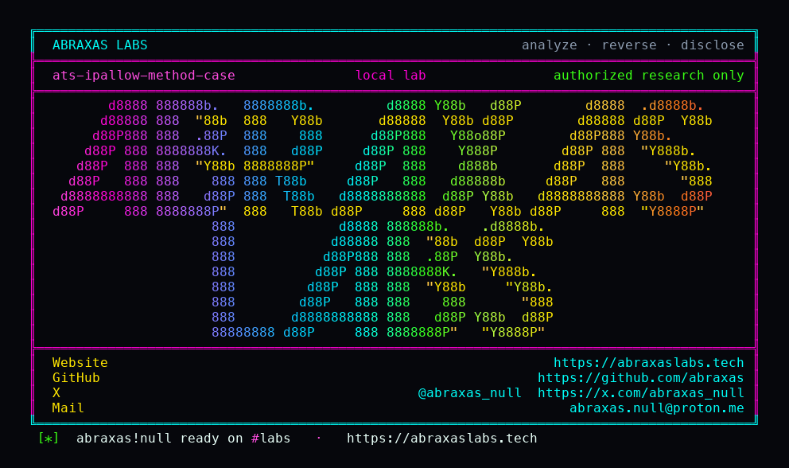

<p align="center">
  
</p>

<p align="center">
  <a href="https://abraxaslabs.tech"><strong>abraxaslabs.tech</strong></a>
  &nbsp;·&nbsp;
  <a href="https://github.com/abraxas">github.com/abraxas</a>
  &nbsp;·&nbsp;
  <a href="https://x.com/abraxas_null">@abraxas_null</a>
  &nbsp;·&nbsp;
  <a href="mailto:abraxas.null@proton.me">abraxas.null@proton.me</a>
  &nbsp;·&nbsp;
  <a href="https://github.com/abraxas/ats-ipallow-method-case">ats-ipallow-method-case</a>
</p>

# ats-ipallow-method-case

**Class:** Privilege leftover
**Reach:** Remote

**Apache Traffic Server** `10.2.0` (`b1df7334`) - Apache Software Foundation

HTTP/1 mixed-case methods skip the default `ip_allow.yaml` deny of PURGE/PUSH/DELETE/TRACE and TUNNEL to the remapped origin as the ATS uid. YAML and remap `@method` parse are nocase. H1 tokenize then `strncmp`s the request bytes and returns `-1` on case mismatch. Deny invert treats that unknown token as allowed. HTTP/2 `:method` is nocase and stays denied. Cache PURGE/PUSH still need a well-known wksidx, so mixed-case does not purge or push the cache.

This is a leftover of the default inbound method ACL, not CVE-2026-33267 (hop-by-hop) and not the inverted empty-nonstandard remap ACL (closed on this pin).

| | |
|---|---|
| ID | no CVE yet |
| Class | **Privilege leftover** |
| Reach | **Remote** (unauthenticated HTTP/1 from a non-loopback client) |
| CWE | [CWE-178](https://cwe.mitre.org/data/definitions/178.html), [CWE-863](https://cwe.mitre.org/data/definitions/863.html) |
| CVSS | **High: 7.5** `CVSS:3.1/AV:N/AC:L/PR:N/UI:N/S:U/C:N/I:H/A:N` |
| Product | [Apache Traffic Server](https://github.com/apache/trafficserver) |
| Affected | **10.2.0** (`b1df7334b39a878971c376da849e8da4984918b6`) default reverse proxy |
| Auth | none. Default `ip_allow.yaml`. `remap_required: 1` plus one `map`. |
| License | [GNU Affero GPL v3.0](LICENSE) |
| Lab | `127.0.0.1:18710` only. Image `ats-10.2.0-lab:local`. |

I pinned tag [10.2.0](https://github.com/apache/trafficserver/releases/tag/10.2.0), commit [`b1df7334b39a878971c376da849e8da4984918b6`](https://github.com/apache/trafficserver/commit/b1df7334b39a878971c376da849e8da4984918b6). Latest Stable 17 Aug 2026. Source-built image, not a gadget.

## What an attacker can do

Reach a typical reverse proxy (`remap_required: 1` plus one `map`) on HTTP/1 from a **non-loopback** address. 127.0.0.1 is allow ALL. Empty `plugin.config`. Default `ip_allow.yaml`.

| Method | Sink | Privilege |
|---|---|---|
| HTTP/1 `delete` / `DeLeTe` after remap from a 172.x sidecar | `hdrtoken_method_tokenize` then `process_quick_http_filter` then `METHOD_NOT_SUPPORTED` TUNNEL ([`HdrToken.cc:512-528`](https://github.com/apache/trafficserver/blob/b1df7334b39a878971c376da849e8da4984918b6/src/proxy/hdrs/HdrToken.cc#L512-L528), [`HttpTransact.cc:6855-6858`](https://github.com/apache/trafficserver/blob/b1df7334b39a878971c376da849e8da4984918b6/src/proxy/http/HttpTransact.cc#L6855-L6858)) | **Integrity (lab-proven):** origin **200** `DELETED ATS-IPALLOW-METHOD-CASE-WITNESS`. Uppercase `DELETE` is **403**. Origin method as ATS uid. |
| HTTP/1 `trace` | same TUNNEL | **Recon (lab-proven):** origin **200** `TRACE-OK`. ATS does not build the TRACE echo (wksidx is not TRACE). Uppercase `TRACE` is **403**. |
| HTTP/1 `purge` / `push` | unknown-method TUNNEL, not cache op | **Integrity (ATS cache): closed (lab-proven).** Origin saw `PURGE-ORIGIN` / `PUSH-ORIGIN`. Cache ops need well-known wksidx. `push_method_enabled` default 0. |
| Same mixed-case request | one extra origin hop | **Availability (lab-proven):** not process death. |

**Lab-proven vs inferred:** uppercase deny, mixed-case DELETE/TRACE tunnel, cache PURGE/PUSH closed: lab. Origin DELETE/TRACE only if that origin folds method case (IIS / some Java). RFC 9110 case-sensitive origins (nginx, httpd, Go) answer 501. Lab origin folds case.

**Requires:** HTTP/1 from a non-loopback client. `remap_required: 1` plus one `map`. Default inbound deny of PURGE/PUSH/DELETE/TRACE. HTTP/2 `:method` nocase still denied.

## Adjacent surface that stays closed

| Surface | Lab |
|---|---|
| Exact-case `DELETE` / `TRACE` from 172.x | **403**, origin not hit |
| HTTP/2 `:method` mixed-case | nocase tokenize, still denied |
| Mixed-case `purge` / `push` as ATS cache ops | origin saw the verb; cache path stayed closed |
| CONNECT dest deny (`0.0.0.0/8`, RFC1918, link-local, `::ffff:0:0/96`) | default `ip_allow.yaml` outbound |
| `remap_required: 1` miss | 404, not an open relay |
| Inverted empty-nonstandard remap ACL | CHANGELOG fix held |
| CVE-2026-33267 hop-by-hop / `@` strip | closed on this pin |

## How I found it

Default `ip_allow.yaml` is the stock remote method ACL. YAML load uses `hdrtoken_tokenize` (nocase). DENY invert then sets `_method_mask = ALL & ~listed` and `_deny_nonstandard_methods = true` with an empty nonstandard list ([`IPAllow.cc:545-548`](https://github.com/apache/trafficserver/blob/b1df7334b39a878971c376da849e8da4984918b6/src/proxy/IPAllow.cc#L545-L548)).

HTTP/1 parse tokenizes with `hdrtoken_method_tokenize`. The DFA is case-insensitive; the helper then `strncmp`s the request bytes against the well-known string and returns `-1` on case mismatch:

```c
retval = hdrtoken_tokenize(string, string_len, &string_out);
if (retval >= 0) {
  if (strncmp(string, string_out, string_len) != 0) {
    // Not a case match
    retval = -1;
  }
}
```

`EndRemapRequest` asks `isNonstandardMethodAllowed` for `method == -1` ([`IPAllow.h:365-376`](https://github.com/apache/trafficserver/blob/b1df7334b39a878971c376da849e8da4984918b6/include/proxy/IPAllow.h#L365-L376)). Empty nonstandard set plus deny-nonstandard is `!method_in_set`, so mixed-case is **allowed**. `is_this_http_method_supported(-1)` is false. `METHOD_NOT_SUPPORTED` sets `ProxyMode_t::TUNNELLING` and returns true. Docs say ATS forwards unknown methods to the origin. Cache lookup is skipped in TUNNELLING.

HTTP/2 `:method` goes through `HTTPHdr::method_set` -> `hdrtoken_tokenize` with no case check. H2 `delete` becomes DELETE and is denied. This leftover is HTTP/1.

Wrong turns: treating RFC 9110 case-sensitive origins as making the deny list a no-op (ATS cache PURGE/PUSH stay closed; origin DELETE/TRACE is the leftover); curling from 127.0.0.1 (allow ALL); claiming cache purge; re-filing hop-by-hop.

Theatre: a reverse shell. The oracle is a witness string on the origin after uppercase 403.

## Lab

```bash
python3 ats-ipallow-method-case-Abraxas-Labs.py
```

or

```bash
cd lab
./run.sh
```

Loopback `127.0.0.1:18710`. Compose project `ats-ipallow-method-case`. Image `ats-10.2.0-lab:local` (source build of 10.2.0). Attacker sidecar on 172.x so localhost ALL does not hide the deny. Origin folds method case. Witness `ATS-IPALLOW-METHOD-CASE-WITNESS`. Last line:

```
SUCCESS ats-ipallow-method-case how=live control=DELETE/TRACE-403 poc=delete/DeLeTe/trace-tunneled cache-purge-push=closed ATS-IPALLOW-METHOD-CASE-WITNESS
```

## The fix

Tokenize HTTP/1 methods the same way YAML and HTTP/2 already do (nocase), or match `ip_allow.yaml` deny names nocase before the unknown-method TUNNEL. Keep cache PURGE/PUSH on well-known wksidx. Do not treat a case variant of a denied well-known method as a new method.

## References

- [github.com/apache/trafficserver](https://github.com/apache/trafficserver) tag [10.2.0](https://github.com/apache/trafficserver/releases/tag/10.2.0) (`b1df7334b39a878971c376da849e8da4984918b6`)
- [`HdrToken.cc`](https://github.com/apache/trafficserver/blob/b1df7334b39a878971c376da849e8da4984918b6/src/proxy/hdrs/HdrToken.cc) `hdrtoken_method_tokenize`
- [`IPAllow.cc`](https://github.com/apache/trafficserver/blob/b1df7334b39a878971c376da849e8da4984918b6/src/proxy/IPAllow.cc) DENY invert
- [`IPAllow.h`](https://github.com/apache/trafficserver/blob/b1df7334b39a878971c376da849e8da4984918b6/include/proxy/IPAllow.h) `isNonstandardMethodAllowed`
- [`HttpTransact.cc`](https://github.com/apache/trafficserver/blob/b1df7334b39a878971c376da849e8da4984918b6/src/proxy/http/HttpTransact.cc) `METHOD_NOT_SUPPORTED` TUNNEL
- [`ip_allow.yaml.default`](https://github.com/apache/trafficserver/blob/b1df7334b39a878971c376da849e8da4984918b6/configs/ip_allow.yaml.default)
- [CWE-178](https://cwe.mitre.org/data/definitions/178.html) · [CWE-863](https://cwe.mitre.org/data/definitions/863.html)
